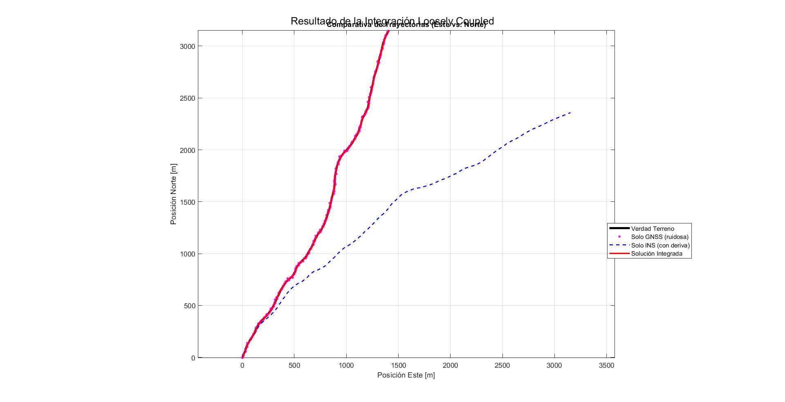
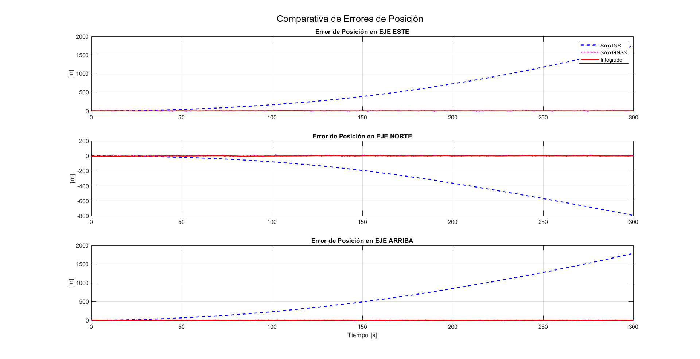
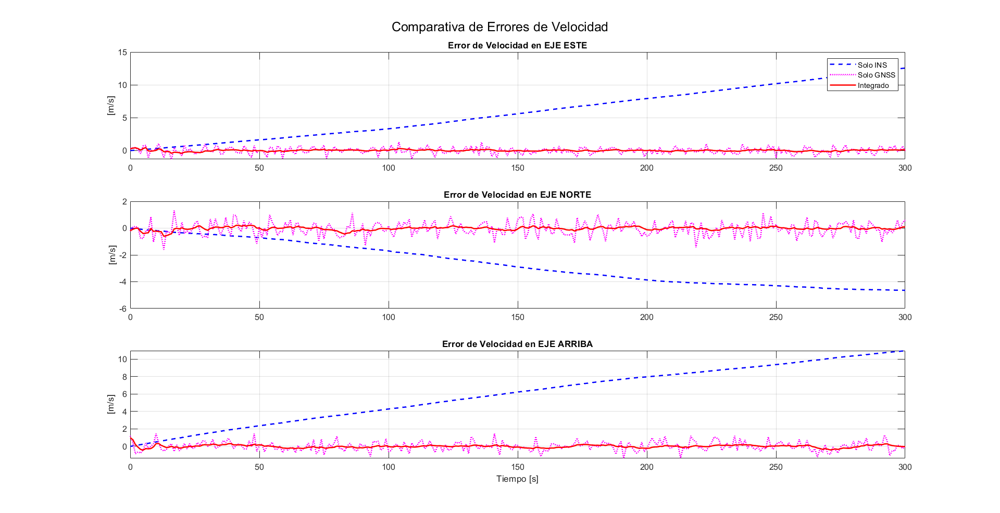
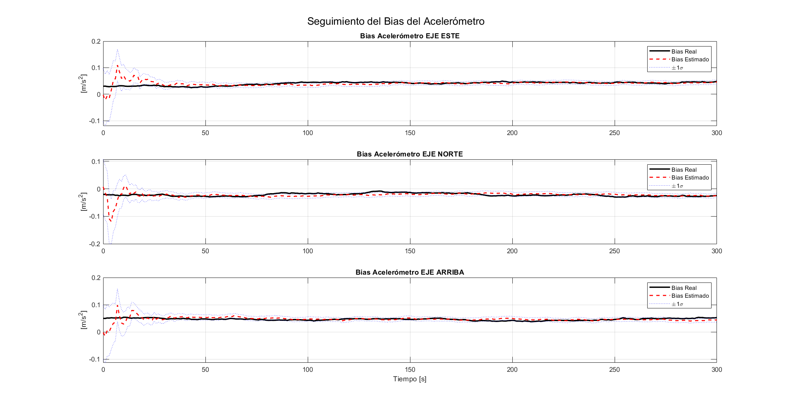

# Loosely Coupled INS/GNSS Integration with a Kalman Filter

A **MATLAB** simulation of a navigation system that fuses an **INS** (inertial navigation system) and a **GNSS** receiver using an error-state **Kalman filter** in a *loosely coupled* architecture.

Neither sensor is good enough on its own:
- The **INS** gives high-rate, low-noise data, but integrating the accelerometer bias makes **its drift grow without bound**.
- The **GNSS** does not drift, but its measurements are **noisy** and arrive at a low rate.

The filter combines both: it uses GNSS to estimate and correct the INS errors, including the accelerometer bias.



## What the script does

1. **True trajectory (*ground truth*)**: 300 s of motion in ENU coordinates. The velocity on each axis is a mean value plus a first-order Gauss–Markov random fluctuation, so the path is not a straight line.
2. **Simulated GNSS** at **1 Hz**: true position and velocity plus white noise (σ = 5 m and σ = 0.5 m/s).
3. **Simulated INS** at **100 Hz**: integrates the measured acceleration, which includes an initial bias, a bias random walk and white noise (*dead reckoning*).
4. **9-state Kalman filter**:

   $$x = [\delta p_{E,N,U},\ \delta v_{E,N,U},\ b_{a,E,N,U}]^T$$

   - Measurement: INS − GNSS difference in position and velocity.
   - Feedback (*closed loop*): after each update, the INS trajectory is corrected from that point onwards and the position and velocity errors are reset to zero.
5. **Plots**: 2D trajectory, position and velocity errors per axis, and estimated vs. true bias with its ±1σ band.

## Results

| Position errors | Velocity errors |
|---|---|
|  |  |

**Accelerometer bias estimation:**



## Running it

**Requirements:** MATLAB R2018b or later (for `sgtitle`). No toolboxes are needed.

```matlab
integracionINS_GNSS
```

The script loads no external data: it generates everything on each run. Since it uses `randn`, every run gives different results. To make them reproducible, add `rng(0)` at the top.

## Main parameters

| Parameter | Value | Description |
|---|---|---|
| `T_obs` | 300 s | Simulation length |
| `h` | 0.01 s | INS step (100 Hz) |
| `T_s` | 1 s | GNSS / filter step (1 Hz) |
| `sigma_gnss_pos` | 5 m | GNSS position noise |
| `sigma_gnss_vel` | 0.5 m/s | GNSS velocity noise |
| `initial_bias_acc` | [0.03, −0.02, 0.05] m/s² | Initial accelerometer bias |
| `sigma_acc_noise` | 0.05 m/s² | Accelerometer noise |
| `sigma_acc_drift` | 0.001 | Bias random walk intensity |

## Structure

```
.
├── integracionINS_GNSS.m   # Full simulation script
└── graphs/                 # Result plots
```

> Code comments and plot labels are in Spanish.

## Author

**Brando Fraiz Freire** · [@bran2ff](https://github.com/bran2ff)
